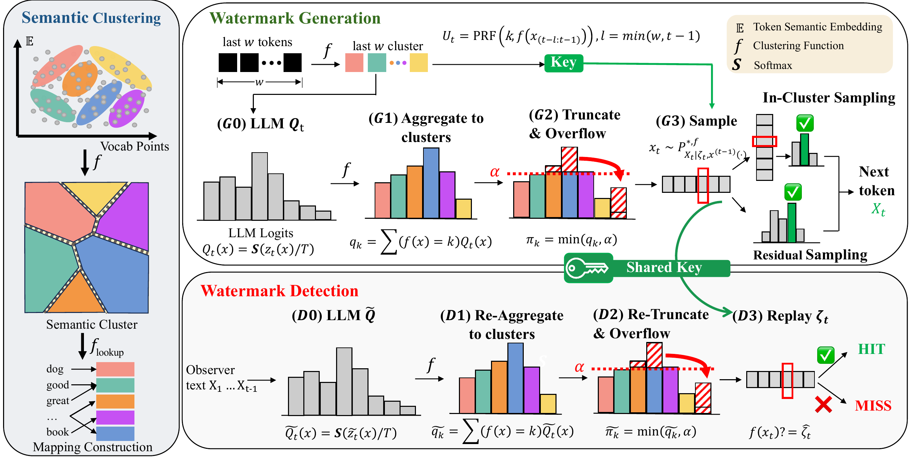

# PASA: A Principled Embedding-Space Watermarking Approach for LLM-Generated Text under Semantic-Invariant Attacks

<p align="center">
  <b>ICML 2026</b>
</p>

<p align="center">
  <b>Zhenxin Ai, Haiyun He</b><br>
  The Hong Kong University of Science and Technology (Guangzhou)
</p>

<p align="center">
  <a href="https://your-paper-link.com"></a>
  <a href="https://your-project-page.com"></a>
  <a href="#"></a>
</p>

<p align="center">
  
</p>

## Overview

This repository provides the official implementation of **PASA**, a principled embedding-space watermarking method for LLM-generated text under semantic-invariant attacks.

---

## Files

```text
PASA/
├── experiment.sh      # Example script for reproduction
├── generation.py      # Generation and detection script
├── utils.py           # Model loading utilities
├── watermark.py       # Core PASA watermark implementation
└── README.md
```

---

## Installation

```bash
git clone https://github.com/your-name/PASA.git
cd PASA

conda create -n pasa python=3.10 -y
conda activate pasa

pip install torch transformers accelerate datasets pandas tqdm nltk tokenizers
python -c "import nltk; nltk.download('punkt')"
```


---

## Reproduction

Edit `experiment.sh`:

```bash
#!/usr/bin/env bash
set -e

export CUDA_VISIBLE_DEVICES=0

python generation.py \
  --watermark_model "/path/to/watermark_model" \
  --auxilary_model "/path/to/auxiliary_model" \
  --c4_dataset_path "/path/to/c4_dataset" \
  --c4_subset "realnewslike" \
  --key_map_path "/path/to/token_to_cluster_mapping.csv" \
  --output_csv "./outputs/results.csv" \
  --num_samples 200 \
  --num_semantic_keys 4 \
  --alpha 0.4 \
  --key 123 \
  --top_p 1.0 \
  --start 3 \
  --window_size 3 \
  --T 1.0 \
  --max_new_tokens 300 \
  --min_new_tokens 200
```

Then run:

```bash
chmod +x experiment.sh
./experiment.sh
```

Please replace the following paths:

| Placeholder | Description |
|---|---|
| `/path/to/watermark_model` | LLM used for watermarked generation |
| `/path/to/auxiliary_model` | Auxiliary model used for detection |
| `/path/to/c4_dataset` | Local C4 dataset directory |
| `/path/to/token_to_cluster_mapping.csv` | Token-to-cluster mapping file |
| `./outputs/results.csv` | Output CSV file |

> Note: `--auxilary_model` is kept for compatibility with the released code.

---

## Demo

You can also directly use PASA in Python:

```python
import torch

from utils import load_model
from watermark import Watermark

device = torch.device("cuda" if torch.cuda.is_available() else "cpu")

watermark_model, watermark_tokenizer = load_model("/path/to/watermark_model")
auxilary_model, auxilary_tokenizer = load_model("/path/to/auxiliary_model")

watermark = Watermark(
    device=device,
    watermark_tokenizer=watermark_tokenizer,
    watermark_model=watermark_model,
    auxilary_tokenizer=auxilary_tokenizer,
    auxilary_model=auxilary_model,
    key_map_path="/path/to/token_to_cluster_mapping.csv",
    num_semantic_keys=4,
    alpha=0.4,
    top_p=1.0,
    key=123,
    T=1.0,
    start=3,
    window_size=3,
    max_new_tokens=300,
    min_new_tokens=200,
)

prompt = "Large language models have shown remarkable capabilities in"

uwm_text = watermark.generate_unwatermarked(prompt)
wm_text = watermark.generate_watermarked(prompt)

uwm_score = watermark.detection(uwm_text)
wm_score = watermark.detection(wm_text)

print("Unwatermarked text:")
print(uwm_text)

print("\nWatermarked text:")
print(wm_text)

print("\nUnwatermarked score:", uwm_score)
print("Watermarked score:", wm_score)
```

---

## Output

The reproduction script saves results to a CSV file.

Main columns:

| Column | Description |
|---|---|
| `prompt` | Prompt used for generation |
| `human` | Human-written text |
| `uwm_text` | Unwatermarked generated text |
| `wm_text` | Watermarked generated text |
| `human_hit_rate` | Detection score of human text |
| `uwm_hit_rate` | Detection score of unwatermarked text |
| `wm_hit_rate` | Detection score of watermarked text |

---

## Citation

If you find this repository useful, please cite:

```bibtex
@inproceedings{ai2026pasa,
  title     = {PASA: A Principled Embedding-Space Watermarking Approach for LLM-Generated Text under Semantic-Invariant Attacks},
  author    = {Ai, Zhenxin and He, Haiyun},
  booktitle = {Proceedings of the International Conference on Machine Learning},
  year      = {2026}
}
```
